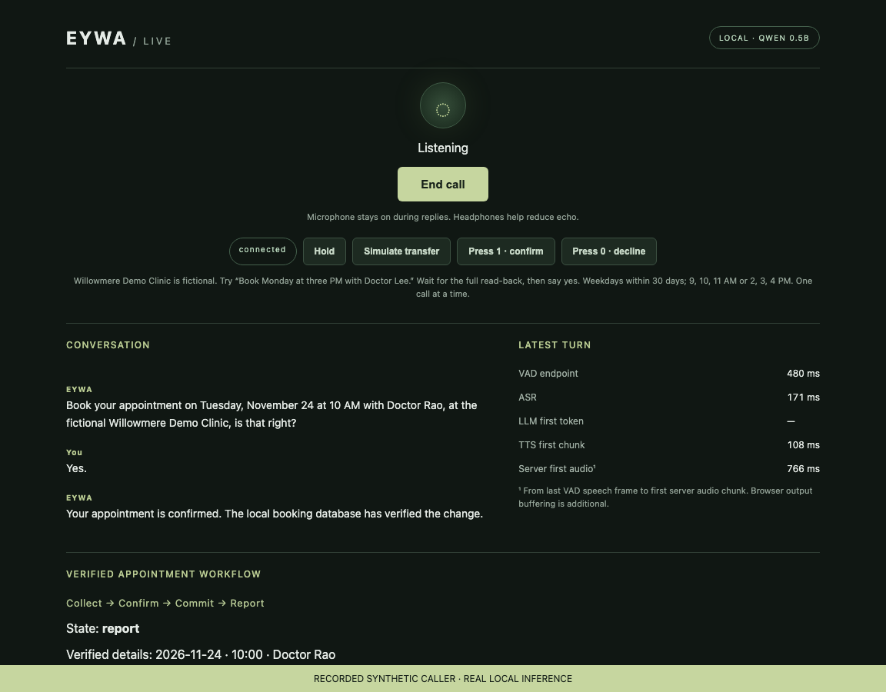

# EYWA — Local Voice AI

A voice platform for an **8 GB Apple M2**, with local inference, interruption,
verified appointment actions, and audio-in/audio-out evaluation. No paid API,
mandatory cloud service, Docker inference, or external telemetry.

| Module | What it does |
|---|---|
| **Live** | Browser mic → Silero VAD → whisper.cpp → llama.cpp → Piper → browser audio, with cancellation and playback-confirmed history |
| **Connect** | Fictional clinic appointments, SQLite transactions, spoken read-back, explicit confirmation, idempotency and caller authorization |
| **Eval** | 30 versioned synthetic voice scenarios, perturbations, state-based scoring, saved JSON reports and synthetic audio replay |
| **Dashboard** | Live transcript, stage timings, booking state, simulated call controls, evaluation progress and report browser |

The latest validation state and remaining limitations are in [docs/status.md](docs/status.md).
Implementation is not a claim that every adversarial voice scenario succeeds; see
actual reports under [benchmarks/](benchmarks/).

The final measured suite passed **30/30 task expectations**, with **zero false
confirmations and duplicate booking writes**. Voice-to-voice p50/p95 was **1,054 /
1,287 ms**; conservative backend/runner peak RSS was **1.386 GB**. Mean known-script
ASR WER was **19.62%** (phone cases **22.22%**). These are bounded synthetic-fixture
results, not guarantees for arbitrary callers. See [the full report and measurement
limits](benchmarks/phase3/summary.md).

[](docs/demo.mp4)

[Watch the recorded booking demo](docs/demo.mp4) — labelled synthetic caller,
real local inference, actual spoken read-back and SQLite-confirmed result.

## Quick start

Requires Apple Silicon macOS, Homebrew Python 3.11, Node/npm, CMake, FFmpeg and git.
Pinned whisper.cpp and llama.cpp builds use Metal natively. Model revisions and
SHA-256 values are in [scripts/download_models.py](scripts/download_models.py).
Python transitive versions are constrained by `requirements-lock.txt`; frontend
packages use `web/package-lock.json`.

```sh
make setup                          # First setup: internet needed for dependencies/models
EYWA_MODEL_PROFILE=compact make dev  # Offline afterwards; http://127.0.0.1:8000
```

Open the local URL in Chrome, click **Start voice call**, and allow microphone
access. Headphones help with echo. The local server must remain running for the
link to work. Stop it with Ctrl+C.

| Profile | Local LLM | Selection |
|---|---|---|
| `balanced` (default) | Qwen2.5-1.5B-Instruct Q4_K_M | `make dev` |
| `compact` | Qwen2.5-0.5B-Instruct Q4_K_M | `EYWA_MODEL_PROFILE=compact make dev` |

The startup log, health response, UI and reports identify the profile. There is no
silent model/mock fallback. Every model load checks available memory against its
measured requirement and a **512 MiB reserve**. A refusal explains the reason and
cleans up earlier loads. Do not force-load models under memory pressure.

## Try a verified booking

Select **Fictional clinic booking**, start a call, and say:

> Book Monday at three PM with Doctor Lee.

Listen to the entire read-back, then say **yes** (or press **1**). A write occurs
only after the read-back finishes and the caller explicitly confirms. Success
speech is generated from the committed database result. Say **no** to discard a
proposal, give revised details before confirming, or ask to cancel your appointment.

**Willowmere Demo Clinic is fictional.** Supported appointments are weekdays in
the next thirty days, at 9, 10, 11 AM or 2, 3, 4 PM with Doctor Lee or Rao. Relative
weekdays use America/New_York. Ambiguous/unsupported expressions require clarification.
This is scheduling, not medical advice or a real clinic integration.

A browser's opaque HttpOnly caller cookie scopes its appointments. Other callers'
records cannot be listed, read, or changed. This is **local demo authorization**,
not real-world identity verification. Repeating a write or request does not create
another appointment. There is **one concurrent call or evaluation** on this machine.

## Simulated telephone line

Enable **Phone quality · G.711** before starting a call. Both directions are
converted to 8 kHz mu-law and back. Ingress supports seeded latency, jitter and
packet loss; egress applies the codec without network perturbations. A bounded
FIFO avoids accumulating the configured delay once per packet.

Hold, resume, transfer and hangup are simulated states. **Transfer reaches no real
person or telephone network.** DTMF is accepted as real PCM tones in evaluations
and as explicit key presses in the UI. Pressing 1 before the read-back completes
cannot commit a booking.

## Tests and evaluation

```sh
make test                     # All Pytest + Playwright checks and TypeScript/Vite build
make eval                     # Full 30-scenario real audio suite; compact profile by default
make bench-phase1             # Real pipeline + browser-fixture latency/interruption checks
make check-adapters           # Real inference adapters loaded separately
```

End/stop the dev server before `make eval`, which loads its own resident model
group. Alternatively, end the call and choose **Run 30 voice scenarios** in the
UI; that uses the server's already-loaded models. The UI also supports stopping
an evaluation. Run `make browser` if the pinned Playwright browser is missing.

To reproduce scenario dates and perturbations from a saved report:

```sh
.venv/bin/python scripts/run_eval.py --profile compact --seed 42 --reference-date 2026-11-21
```

The suite uses a different real Piper speaker for the caller and sends paced PCM
through production VAD, ASR, constrained LLM extraction, workflow and TTS. Its
transport is an **in-process client of the production VoiceSession**, not a browser
or physical device. Separate Playwright and real browser-fixture checks cover the
WebSocket/UI path. No inference mocks are selected by the evaluator.

Scenarios include noise, speed changes, phone codec, missing/ambiguous details,
changes of mind, repeated requests, mid-reply interruption, DTMF, unauthorized
requests, and an explicitly injected database failure. Scores use **SQLite state**,
actual outgoing success clauses and known-script ASR WER—no LLM judge.

Reports include per-scenario and aggregate task success, false confirmations,
duplicate writes, ASR WER, voice-to-voice timings and barge-in results. They save
hardware, date, source/commit, models, settings, seed, reference date, and scenario
hash. Fixed seeds make software perturbations reproducible; native scheduling and
timing are not bitwise deterministic. Failed scenarios remain in reports.

## Architecture

```mermaid
flowchart LR
    Mic[Browser microphone] --> AW[16 kHz AudioWorklet]
    AW --> WS[WebSocket / optional phone codec]
    WS --> VAD[Silero VAD + endpointing]
    VAD --> ASR[whisper.cpp]
    ASR --> Mode{Call mode}
    Mode -->|Live| LLM[llama.cpp token stream]
    Mode -->|Clinic| JSON[Constrained JSON + grounded fields]
    JSON --> FSM[Collect → Confirm → Commit → Report]
    FSM --> DB[(SQLite authorization + idempotency)]
    DB --> Speech[Verified spoken result]
    LLM --> TTS[Resident Piper worker]
    Speech --> TTS
    TTS --> Player[Browser playback]
    Player -->|played acknowledgements| FSM
    Caller[Synthetic caller / speaker 20] --> WS
    DB --> Score[State-based evaluator]
    Score --> Reports[JSON reports + synthetic replay]
```



Each stage has a replaceable interface. Mocks are explicitly named in tests and
labelled at startup/UI. LLM cancellation closes its HTTP stream; TTS cancellation
terminates native synthesis in its owned worker. A speculative reload overlaps
the next caller utterance. Generation IDs fence stale output and playback acks.
Only fully played assistant clauses enter bounded history.

Architecture decisions are recorded in [docs/adr/](docs/adr/). The measured Phase 1
baseline is in [benchmarks/phase1/summary.md](benchmarks/phase1/summary.md).

## Privacy, artifacts and limitations

- **Live microphone audio and transcripts are not saved.** Session text is held in
  bounded memory; local OTel spans contain timing/IDs without speech or exception
  strings. No external exporter is configured. Native transcript logs are discarded.
- Appointment fields are intentionally stored locally for the verified workflow.
  The database holds anonymous caller capabilities, not names, phones or dates of
  birth. Do not use real patient information in this fictional demo.
- Evaluation stores **known synthetic** agent audio under `runtime/eval/` for
  conversation replay and redacts phone/email/DOB patterns in stored traces.
  Synthetic runs older than seven days are removed on server startup; versioned
  benchmark JSON evidence is retained. Models, databases,
  cookies, live logs, dependencies and runtime artifacts are excluded from Git.
- Whisper recognizes VAD-segmented utterances rather than true streaming ASR.
  Piper synthesizes a sentence before streaming its audio chunks.
- Interrupted partial clauses are discarded from history, including some words the
  caller may have heard. Exact word/audio alignment is not claimed.
- Closing an ASR request discards its result but native decode may finish. Native
  model-server crashes require an application restart.
- Transport timing ends at first audio receipt. Browser timing ends at WebAudio
  schedule/stop dispatch. Acoustic device latency is not measured. The user has
  separately confirmed physical microphone replies and successful interruption.
- Small models and phone/noise ASR can fail. Safety gates prevent unconfirmed or
  unauthorized writes, but do not guarantee that every request is understood.
- Claims intake, multiple simultaneous calls, real PSTN access and real human
  escalation are outside this version's single-domain, 8 GB scope.
- The production npm audit was clean during validation. A build-time Vite dependency
  has an upstream picomatch advisory without a patched registry release at setup;
  EYWA serves static assets and does not run Vite's development server.

Piper package/voice licensing is documented in [ADR 0003](docs/adr/0003-tts-voice-and-license.md).
EYWA code is licensed under [GPL-3.0-or-later](LICENSE); third-party licenses and
LibriTTS-R attribution are in [NOTICE.md](NOTICE.md).
The synthetic demo recorder is reproducible with
`.venv/bin/python scripts/record_demo.py` while the local app is running and idle.
Its labelled video uses real inference; audio is reconstructed from generated PCM
and is not a recording of a human caller.
